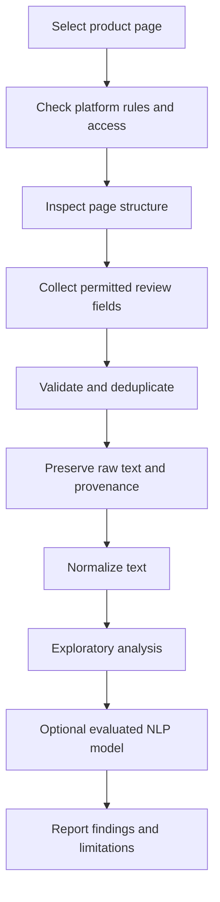
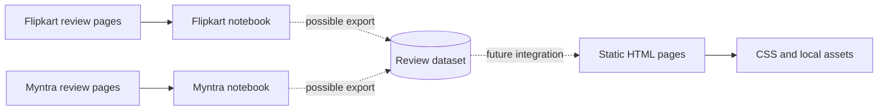

<div align="center">

# 🛍️ Product Review Analysis Using Natural Language Processing

**Exploring e-commerce customer feedback through review collection and NLP**

[](https://github.com/Brajesh31/Analysis-of-products-using-NLP/stargazers)
[](https://github.com/Brajesh31/Analysis-of-products-using-NLP/network)
[](https://github.com/Brajesh31/Analysis-of-products-using-NLP/issues)
[](LICENSE)

</div>

## 📌 Contents
- [Overview](#-overview)
- [Objectives](#-objectives)
- [Repository contents](#-repository-contents)
- [Workflow](#-workflow)
- [Setup](#-setup)
- [Responsible collection](#-responsible-collection)
- [Validation and limitations](#-validation-and-limitations)
- [Documentation](#-documentation)

## 🔎 Overview

This repository explores customer-review collection for products listed on e-commerce platforms. Its tracked contents include separate Jupyter notebooks for Flipkart and Myntra review scraping and a static HTML/CSS frontend under `Frontend/`.

The intended analytical domain is product feedback: review text, ratings, recurring themes, and the relationship between expressed opinion and rating. The checked-in tree does not establish a trained sentiment model, backend API, database, or production NLP pipeline. Those are potential extensions, not current feature claims.

## 🎯 Objectives

1. Explore review collection from the two represented platforms, subject to their current terms and applicable law.
2. Preserve source context and retrieval provenance.
3. Establish a reproducible route from raw feedback to normalized text.
4. Support future exploratory, sentiment, and aspect-level analysis.
5. Make data quality, uncertainty, and limitations explicit.

## 🗂️ Repository contents

| Path | Purpose |
|---|---|
| `Frontend/index.html`, `Frontend/index.css` | Static home page and styles |
| `Frontend/listing.html`, `Frontend/listing.css` | Product/listing page and styles |
| `Frontend/assets/` | Existing images, icons, and SVG assets |
| `Web Scraping – Flipkart Customer Reviews.ipynb` | Flipkart collection notebook |
| `Web Scraping – Myntra Customer Reviews.ipynb` | Myntra collection notebook |
| `docs/` | Project and technical documentation |
| `.github/` | Repository templates and workflows |

See [the structure guide](docs/project-structure.md) for tracked layout and future organization guidance.

## 🔄 Review-analysis workflow



This is a recommended end-to-end workflow. The two notebooks are the current collection entry points; later analytical stages should be marked complete only when implementation and evidence exist.

## 🏛️ Architecture



Dashed arrows represent potential future integration, not a verified runtime connection.

## 🚀 Setup

```bash
git clone https://github.com/Brajesh31/Analysis-of-products-using-NLP.git
cd Analysis-of-products-using-NLP
```

### View the frontend

Open `Frontend/index.html` in a browser, or run:

```bash
python -m http.server 8000 --directory Frontend
```

Visit `http://localhost:8000`. The listing page is available at `/listing.html`.

### Explore the notebooks

Open either notebook in Jupyter Notebook, JupyterLab, or Colab. Inspect its imports and setup cells before running it. The tracked tree does not include a pinned Python dependency manifest, so install only the packages the notebook actually imports and record tested versions before proposing a lockfile.

## 🔐 Responsible collection

- Review current platform terms, robots directives, API policies, and applicable law before collecting.
- Do not bypass authentication, CAPTCHAs, access controls, or rate limits.
- Collect only the minimum fields required for product-feedback analysis.
- Do not build reviewer profiles or infer sensitive personal attributes.
- Do not publish raw user-generated content without a lawful basis and permission.
- Keep credentials, cookies, and tokens out of notebooks and Git history.

See [responsible data guidance](docs/responsible-data.md) and [SECURITY.md](SECURITY.md).

## 🧪 Validation and limitations

A notebook running successfully does not prove that its sample is representative. Any future model report should include dataset size, platform/product coverage, collection window, language distribution, label provenance, train/test strategy, baseline, class-wise metrics, and error analysis.

No dataset counts, model scores, or production deployment claims are published here because the repository inventory does not establish those results.

## 📚 Documentation

- [Documentation index](docs/README.md)
- [Project overview](docs/project-overview.md)
- [Project structure](docs/project-structure.md)
- [Architecture](docs/architecture.md)
- [Workflow](docs/workflow.md)
- [Data schema guidance](docs/data-and-schema.md)
- [NLP methodology](docs/nlp-methodology.md)
- [Responsible data](docs/responsible-data.md)
- [Testing](docs/testing.md)
- [Limitations](docs/limitations.md)
- [Future scope](docs/future-scope.md)
- [Development](docs/development.md)
- [Installation](docs/installation.md)
- [Troubleshooting](docs/troubleshooting.md)

## 🤝 Contributing

Read [CONTRIBUTING.md](CONTRIBUTING.md). Use issue templates and include reproducible steps. Notebook changes must be checked for secrets, private data, execution-order assumptions, and unnecessary outputs.

## 👤 Maintainer

**Brajesh Kumar** · [@Brajesh31](https://github.com/Brajesh31)

Last updated: 2026-11-16 06:26 UTC
