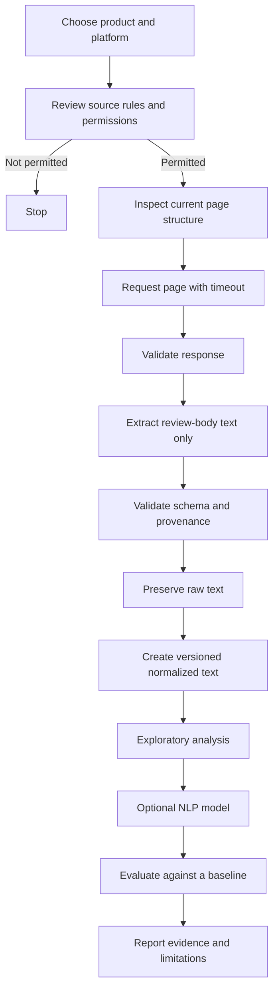
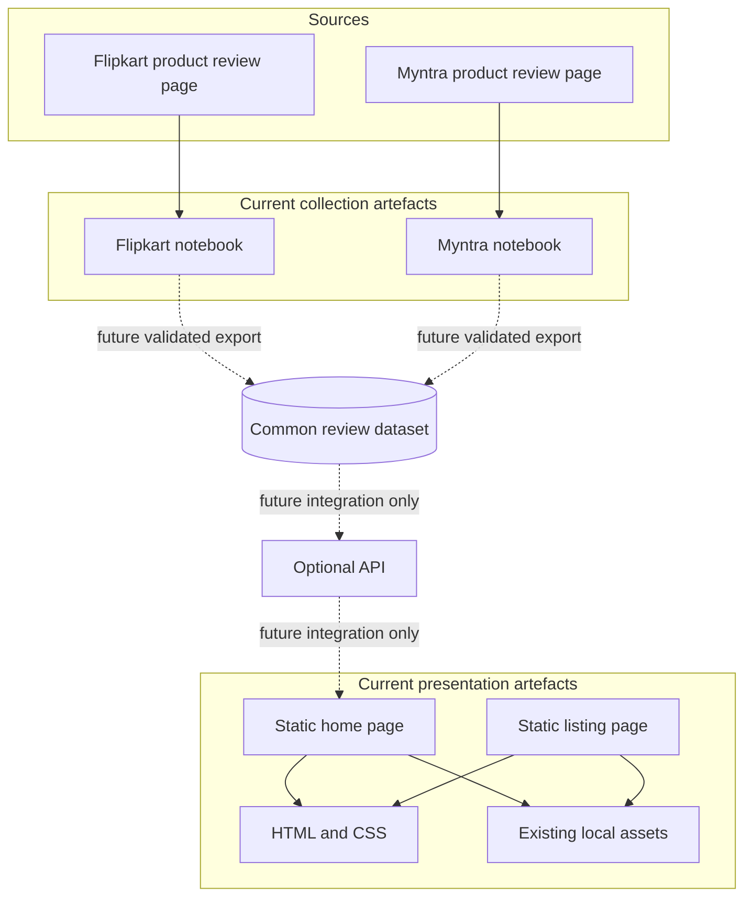

<div align="center">

# 🛍️ Analysis of Products Using NLP

### Turning e-commerce customer feedback into structured product insights

[](https://github.com/Brajesh31/Analysis-of-products-using-NLP/stargazers)
[](https://github.com/Brajesh31/Analysis-of-products-using-NLP/network)
[](https://github.com/Brajesh31/Analysis-of-products-using-NLP/issues)
[](LICENSE)

</div>

---

## 📌 Table of contents

- [🔎 Project overview](#-project-overview)
- [🎯 Problem and objectives](#-problem-and-objectives)
- [🧩 Current implementation](#-current-implementation)
- [🗂️ Repository structure](#️-repository-structure)
- [🔄 Workflow](#-workflow)
- [🏛️ Architecture](#️-architecture)
- [🚀 Installation and setup](#-installation-and-setup)
- [📓 Running the notebooks](#-running-the-notebooks)
- [🧾 Data contract](#-data-contract)
- [🧠 NLP methodology](#-nlp-methodology)
- [🔐 Responsible data practices](#-responsible-data-practices)
- [🧪 Testing and validation](#-testing-and-validation)
- [⚠️ Limitations](#️-limitations)
- [🗺️ Roadmap](#️-roadmap)
- [📚 Documentation](#-documentation)
- [🤝 Contributing](#-contributing)

## 🔎 Project overview

Product reviews contain more than a star rating. Customers describe what works, what fails, which attributes matter, and whether the product met their expectations. These comments are unstructured, often inconsistent, and difficult to compare manually at scale.

**Analysis of Products Using NLP** is an exploratory project focused on e-commerce product feedback. The repository contains two platform-specific review collection notebooks, one for Flipkart and one for Myntra, alongside a static HTML/CSS frontend prototype. The broader project direction is to help people explore product feedback and understand consumer acceptance.

The important distinction is between the current repository and the intended direction. The tracked tree establishes notebooks and a static interface. It does not establish a production sentiment model, backend API, database, automated crawler, or live product/price integration. Those remain future engineering work until implemented and validated.

## 🎯 Problem and objectives

### The problem

A person evaluating a product or competitor may need to understand:
- which product aspects customers praise repeatedly;
- which aspects attract complaints;
- whether written comments align with star ratings;
- what topics appear across a set of reviews;
- whether two product samples are sufficiently comparable to draw a conclusion.

Manually reading every review is time-consuming. Simple rating averages hide the reasons behind customer satisfaction or dissatisfaction.

### Project objectives

1. Explore permitted collection of product-review text from the represented platforms.
2. Preserve source context, product reference, and retrieval timestamp.
3. Establish a shared schema for future analysis.
4. Validate and clean data without destroying original text.
5. Support future exploratory NLP, sentiment, and aspect-level analysis.
6. Report sample size, provenance, uncertainty, and limitations.
7. Maintain a frontend that can later display validated aggregate insights.

## 🧩 Current implementation

| Component | What is present | Important boundary |
|---|---|---|
| Flipkart notebook | Requests and BeautifulSoup-based exploratory collection | Page selector is platform-specific and may become stale |
| Myntra notebook | Requests and BeautifulSoup-based exploratory collection | Page selector is platform-specific and may become stale |
| Static frontend | Home and listing HTML/CSS pages | No verified live API integration |
| Local assets | Existing product, team, logo, and icon assets | Keep relative paths and filename case intact |
| Documentation | Project guides, data and NLP methodology, diagrams, contribution and security guidance | Future proposals are labelled as proposals |

### What is not currently established

The inspected repository does not establish a trained sentiment classifier, model weights, production preprocessing package, backend API, database schema, automated collection scheduler, live price feed, or benchmark report. Do not describe these as shipped features unless code and validation evidence are added.

## 🗂️ Repository structure

```text
Analysis-of-products-using-NLP/
├── .github/
│   ├── ISSUE_TEMPLATE/
│   ├── workflows/
│   └── PULL_REQUEST_TEMPLATE.md
├── Frontend/
│   ├── assets/
│   ├── index.html
│   ├── index.css
│   ├── listing.html
│   └── listing.css
├── docs/
│   ├── decisions/
│   ├── templates/
│   ├── architecture.md
│   ├── workflow.md
│   ├── data-and-schema.md
│   ├── nlp-methodology.md
│   ├── responsible-data.md
│   ├── testing.md
│   └── ...
├── Web Scraping – Flipkart Customer Reviews.ipynb
├── Web Scraping – Myntra Customer Reviews.ipynb
├── README.md
├── CONTRIBUTING.md
├── SECURITY.md
├── CODE_OF_CONDUCT.md
├── GOVERNANCE.md
├── ROADMAP.md
└── LICENSE
```

See [Project structure](docs/project-structure.md) for the detailed file responsibility guide.

## 🔄 Workflow

The repository's current notebooks are collection experiments. The complete process below shows the recommended lifecycle for reliable product-feedback analysis.



The later analytical stages are recommendations, not claims that they are already implemented.

## 🏛️ Architecture



Dashed connections represent proposed future integration. The current frontend does not have a verified live connection to the notebook outputs.

## 🚀 Installation and setup

### Prerequisites

- Git;
- Python 3;
- a modern web browser;
- Jupyter Notebook, JupyterLab, or Google Colab for notebook exploration.

The tracked tree does not currently provide a pinned Python dependency manifest. The notebook imports include Requests and BeautifulSoup. Install the dependencies actually used by the notebook and record tested versions before treating the environment as reproducible.

### Clone the repository

```bash
git clone https://github.com/Brajesh31/Analysis-of-products-using-NLP.git
cd Analysis-of-products-using-NLP
```

### Run the static frontend

From the repository root:

```bash
python -m http.server 8000 --directory Frontend
```

Open [http://localhost:8000](http://localhost:8000). The listing page is available at [http://localhost:8000/listing.html](http://localhost:8000/listing.html).

### Prepare a notebook environment

Create a virtual environment:

```bash
python -m venv .venv
```

Activate it on Windows PowerShell:

```powershell
.venv\Scripts\Activate.ps1
```

Activate it on macOS/Linux:

```bash
source .venv/bin/activate
```

Install the visible notebook dependencies and Jupyter:

```bash
python -m pip install --upgrade pip
python -m pip install jupyter requests beautifulsoup4
jupyter lab
```

This is a starting environment for the inspected imports, not a locked dependency set. See [Installation](docs/installation.md).

## 📓 Running the notebooks

The notebooks are named:
- `Web Scraping – Flipkart Customer Reviews.ipynb`
- `Web Scraping – Myntra Customer Reviews.ipynb`

Before executing a request:
1. Read the notebook introduction and collection safeguards.
2. Confirm that the current platform terms and collection method permit the request.
3. Verify the configured product URL and review-body selector.
4. Run from a fresh kernel.
5. Stop if access is denied or rate-limited.
6. Inspect a small sample privately and confirm it contains review text only.
7. Keep local exports out of Git unless publication is authorized.

The revised notebooks use explicit timeouts, HTTP status checks, narrow candidate selectors, and optional local CSV export disabled by default. The selectors can still become stale. A selector failure is a reason to inspect permitted markup, not to scrape the entire page.

See [Collection notebook guide](docs/collection-notebook-guide.md).

## 🧾 Data contract

A future common review record should preserve source provenance and separate raw text from derived text.

| Field | Purpose |
|---|---|
| `review_id` | Stable source identifier or documented local key |
| `source_platform` | Platform provenance |
| `product_reference` | Product context |
| `retrieved_at` | UTC retrieval timestamp |
| `review_text_raw` | Original review text |
| `review_text_clean` | Derived normalized text |
| `rating_value` | Numeric rating when available |
| `rating_scale_max` | Source rating scale |
| `collection_run_id` | Collection run provenance |
| `parser_version` | Extraction logic version |

This is a proposed contract. Confirm actual source fields before enforcing it. Reviewer names, locations, profile URLs, and contact details are not required for product feedback analysis.

Full details: [Data and schema guide](docs/data-and-schema.md).

## 🧠 NLP methodology

A sound analysis starts with a defined task, not a model name.

Potential tasks include:
- polarity classification;
- aspect-based sentiment;
- topic exploration;
- rating-text agreement;
- product-level comparison under comparable sampling conditions.

Preserve raw text. Treat rating-derived labels as proxy labels, not ground truth. Begin with transparent baselines and evaluate with a leakage-resistant test split. Report class-wise precision, recall, F1, macro-F1, support counts, and error analysis.

See [NLP methodology](docs/nlp-methodology.md) and [Analysis reporting standard](docs/analysis-reporting.md).

## 🔐 Responsible data practices

- Review current platform terms, robots directives, API policies, and applicable law.
- Do not bypass authentication, CAPTCHAs, access controls, paywalls, or rate limits.
- Collect only the minimum fields needed.
- Do not build reviewer profiles or infer sensitive personal attributes.
- Do not publish raw user-generated content without permission.
- Keep cookies, tokens, and credentials out of notebooks and Git history.
- Clear saved notebook outputs that contain reviewer identities or raw page dumps.

See [Responsible data](docs/responsible-data.md) and [Security policy](SECURITY.md).

## 🧪 Testing and validation

The repository quality checks should focus on deterministic validation:
- notebook JSON structure;
- unique notebook cell IDs;
- Markdown structure and internal links;
- synthetic parser fixtures;
- mocked HTTP responses;
- frontend asset paths and browser behaviour;
- keyboard access and responsive layout.

CI must not send live scraping requests to retail platforms. Model evaluation requires a documented dataset, label provenance, baseline, held-out split, and error analysis.

See [Testing](docs/testing.md).

## ⚠️ Limitations

Online reviews are self-selected and may not represent all customers. Platform markup changes. Review ordering and moderation affect observed samples. Ratings are not perfect sentiment labels. Models may misread sarcasm, negation, code-mixed language, and domain-specific phrases.

Do not compare raw percentages without sample sizes, source coverage, collection windows, and rating-scale context. Do not claim model accuracy without a held-out evaluation.

See [Limitations](docs/limitations.md).

## 🗺️ Roadmap

1. **Notebook reliability:** safe requests, narrow selectors, sanitized outputs, tested environment.
2. **Common schema:** validation, provenance, deduplication, and run manifests.
3. **Exploratory analysis:** review coverage, rating, language, and topic summaries.
4. **NLP evaluation:** label policy, baseline, held-out metrics, and error analysis.
5. **Frontend quality:** accessibility, responsive design, and transparent data freshness.
6. **Operational maturity:** deterministic CI, release notes, retention, and monitoring only where justified.

See [ROADMAP.md](ROADMAP.md) and [Future scope](docs/future-scope.md).

## 📚 Documentation

| Guide | Description |
|---|---|
| [Documentation index](docs/README.md) | Full navigation |
| [Project overview](docs/project-overview.md) | Problem, goals, and implementation boundary |
| [Project structure](docs/project-structure.md) | Tracked files and responsibilities |
| [Architecture](docs/architecture.md) | Current components and future boundaries |
| [Workflow](docs/workflow.md) | Collection-to-report lifecycle |
| [Notebook guide](docs/collection-notebook-guide.md) | Selector assumptions and safe execution |
| [Data schema](docs/data-and-schema.md) | Common record and validation rules |
| [NLP methodology](docs/nlp-methodology.md) | Preprocessing, labels, baselines, evaluation |
| [Analysis reporting](docs/analysis-reporting.md) | Charts, metrics, and reporting standard |
| [Responsible data](docs/responsible-data.md) | Privacy, collection, and retention |
| [Testing](docs/testing.md) | Validation strategy |
| [Accessibility](docs/accessibility.md) | Frontend and visualization checklist |
| [Diagrams](docs/diagrams.md) | Editable Mermaid diagrams |
| [Installation](docs/installation.md) | Local setup |
| [Development](docs/development.md) | Contribution workflow |
| [API](docs/api.md) | Current API status and future contract |
| [Database](docs/database.md) | Persistence design considerations |
| [Deployment](docs/deployment.md) | Static hosting guidance |
| [Troubleshooting](docs/troubleshooting.md) | Common failures |
| [Limitations](docs/limitations.md) | Data and implementation constraints |
| [Future scope](docs/future-scope.md) | Phased extension plan |

## 🧭 Repository policies and maintenance

- [Contribution guide](CONTRIBUTING.md): branch, notebook, testing, and pull-request standards.
- [Security policy](SECURITY.md): safe collection, secret handling, and private reporting.
- [Code of conduct](CODE_OF_CONDUCT.md): community expectations and enforcement.
- [Governance](GOVERNANCE.md): project decisions and review principles.
- [Accessibility statement](ACCESSIBILITY.md): frontend and visualization expectations.
- [Release process](RELEASE.md): release readiness and rollback.
- [Technical debt register](TECHNICAL_DEBT.md): verified gaps and priority order.
- [Maintainers](MAINTAINERS.md): repository ownership and responsibilities.
- [Support](SUPPORT.md): how to report reproducible issues safely.

## 🤝 Contributing

Contributions are welcome when they improve correctness, reproducibility, safety, accessibility, or maintainability. Read [CONTRIBUTING.md](CONTRIBUTING.md), use the issue templates, and include exact validation evidence. Do not commit credentials, cookies, private datasets, or notebook outputs containing personal information.

## 👤 Maintainer

**Brajesh Kumar** · [@Brajesh31](https://github.com/Brajesh31)

---

⭐ If this project is useful, consider starring the repository and opening a focused issue with a concrete improvement.

Last updated: 2026-11-16
