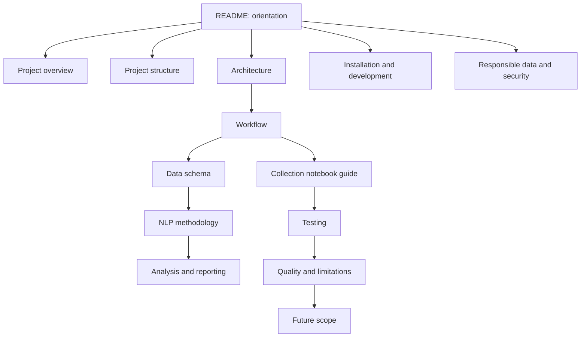

# 📚 Complete project documentation index

This directory documents the current repository and provides a practical extension guide. The current implementation includes platform-specific review collection notebooks and a static HTML/CSS frontend. Proposed APIs, databases, automated NLP pipelines, and model evaluations are clearly labelled as future work until their code and evidence are committed.

## 🧭 Start here

| If you want to... | Read |
|---|---|
| Understand the project purpose and current boundaries | [Project overview](project-overview.md) |
| Find a file or understand where code belongs | [Project structure](project-structure.md) |
| Understand current and proposed components | [Architecture](architecture.md) |
| Follow collection through analysis | [Workflow](workflow.md) |
| Understand the notebook selectors and their risks | [Collection notebook guide](collection-notebook-guide.md) |
| Define a review record | [Data schema](data-and-schema.md) |
| Plan text processing and model evaluation | [NLP methodology](nlp-methodology.md) |
| Report charts and analytical conclusions responsibly | [Analysis and reporting](analysis-reporting.md) |
| Review collection, privacy, and retention safeguards | [Responsible data](responsible-data.md) |
| Validate notebooks, data, and frontend changes | [Testing](testing.md) |
| Check accessibility expectations | [Accessibility](accessibility.md) |
| Review editable Mermaid diagrams | [Diagrams](diagrams.md) |
| Prepare a local environment | [Installation](installation.md) |
| Make a code or documentation contribution | [Development](development.md) |
| Understand the proposed API boundary | [API status](api.md) |
| Understand persistence options | [Database design](database.md) |
| Publish the static frontend | [Deployment](deployment.md) |
| Diagnose a problem | [Troubleshooting](troubleshooting.md) |
| Understand known gaps | [Limitations](limitations.md) |
| Review future work | [Future scope](future-scope.md) |
| Find common answers | [FAQ](faq.md) |

## 📐 Documentation architecture

## 🧪 Documentation quality rules

1. State whether a component is implemented, proposed, or intentionally out of scope.
2. Do not invent model scores, dataset sizes, screenshots, API routes, or database tables.
3. Use synthetic records in examples unless real data is approved for publication.
4. Keep diagrams editable in Mermaid source.
5. Include prerequisites, steps, expected outcomes, failure cases, and validation where relevant.
6. Avoid repeating generic filler across documents; each guide should answer a distinct question.
7. Update this index and the root README whenever a guide is added, renamed, or removed.
8. Review internal links before merging.

## 🔐 Data handling reminder

The review notebooks deal with user-generated content. Never commit credentials, cookies, private review datasets, reviewer identities, or notebook outputs that expose personal information. Read [Responsible data](responsible-data.md) and the root [Security policy](../SECURITY.md) before collection or publication.
