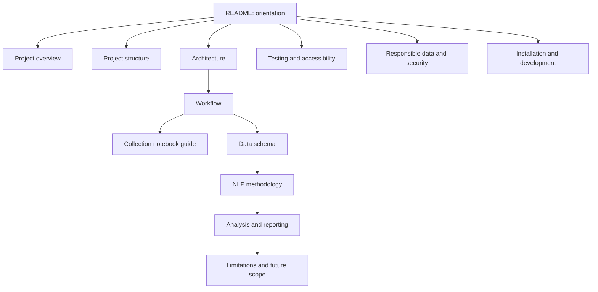

# 📚 Complete project documentation index

This directory documents the current repository and provides a practical extension guide. The current implementation includes platform-specific review collection notebooks and a static HTML/CSS frontend. Proposed APIs, databases, automated NLP pipelines, and model evaluations are clearly labelled as future work until their code and evidence are committed.

## 🧭 Start here

| Need | Guide |
|---|---|
| Understand project purpose and current boundaries | [Project overview](project-overview.md) |
| Find a file and understand where code belongs | [Project structure](project-structure.md) |
| Understand current and proposed components | [Architecture](architecture.md) |
| Follow collection through analysis | [Workflow](workflow.md) |
| Understand the two existing scraping notebooks | [Collection notebook guide](collection-notebook-guide.md) |
| Define and validate a review record | [Data schema](data-and-schema.md) |
| Plan text processing and model evaluation | [NLP methodology](nlp-methodology.md) |
| Report metrics and visualizations responsibly | [Analysis and reporting](analysis-reporting.md) |
| Review editable system diagrams | [Diagrams](diagrams.md) |
| Review privacy, collection, and retention safeguards | [Responsible data](responsible-data.md) |
| Validate notebook, data, and frontend changes | [Testing](testing.md) |
| Check accessibility expectations | [Accessibility](accessibility.md) |
| Prepare a local environment | [Installation](installation.md) |
| Contribute code or documentation | [Development](development.md) |
| Understand future API design | [API status](api.md) |
| Understand persistence choices | [Database design](database.md) |
| Publish the static frontend | [Deployment](deployment.md) |
| Diagnose setup or runtime issues | [Troubleshooting](troubleshooting.md) |
| Understand implementation and data gaps | [Limitations](limitations.md) |
| Review proposed future work | [Future scope](future-scope.md) |
| Find common answers | [FAQ](faq.md) |

## 📐 Documentation architecture

## 🧠 Decision records and reusable templates

- [Architecture decision records](decisions/README.md) explains when and how to record consequential design choices.
- [ADR template](templates/architecture-decision-record.md) captures context, options, rationale, consequences, and validation.
- [Analysis report template](templates/analysis-report-template.md) standardizes evidence, metrics, and limitations.

## 🧪 Documentation quality rules

1. State whether a component is implemented, proposed, or out of scope.
2. Do not invent model scores, dataset sizes, screenshots, endpoints, or database tables.
3. Use synthetic records unless real data is approved for publication.
4. Keep diagrams editable in Mermaid source.
5. Include prerequisites, steps, expected outcomes, failure cases, and validation where relevant.
6. Avoid generic filler; each guide should answer a distinct project-specific question.
7. Update this index and the root README whenever a guide is added, renamed, or removed.
8. Review relative links and code fences before merging.

## 🔐 Data handling reminder

The notebooks handle user-generated content. Never commit credentials, cookies, private review datasets, reviewer identities, or notebook outputs that expose personal information. Read [Responsible data](responsible-data.md) and the root [Security policy](../SECURITY.md) before collection or publication.
