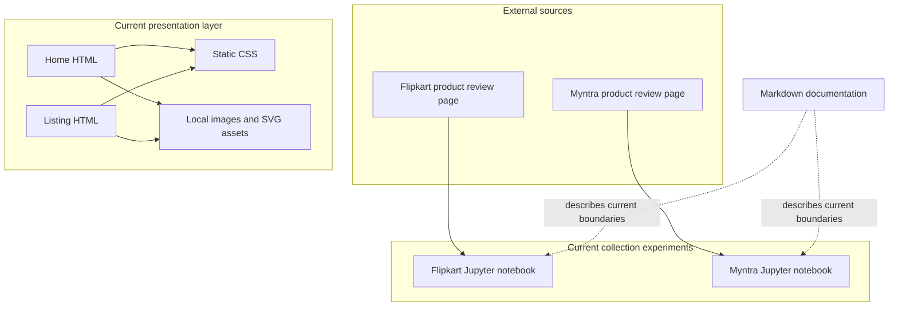
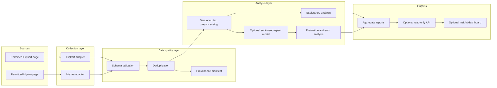

# 🏛️ Architecture and system boundaries

## 1. Architecture purpose

This document separates the repository's verified current components from a recommended future product architecture. It is intentionally conservative: a diagram should describe code that exists or clearly label a proposed component. A database, API, trained model, or live integration must not appear as an implemented service unless its source code and tests are present.

## 2. Current architecture

The tracked project contains:
1. a Requests/BeautifulSoup notebook for a Flipkart product review page;
2. a Requests/BeautifulSoup notebook for a Myntra product review page;
3. static home and listing pages under `Frontend/`;
4. local CSS, image, logo, and SVG assets;
5. repository documentation and GitHub automation.

There is no verified runtime edge between the notebook outputs and the frontend. The notebooks run independently and the static pages should not be described as displaying live notebook results.

## 3. Collection component responsibilities

### Flipkart adapter experiment

The Flipkart notebook requests one configured product page, validates the response, parses HTML, and extracts text from a candidate review-body selector. The selector must be verified against the current permitted markup. The notebook does not implement pagination, dynamic browser interaction, a scheduler, or a shared reusable adapter package.

### Myntra adapter experiment

The Myntra notebook follows the same broad sequence but uses a platform-specific review-text selector. Keeping the selectors separate is important because the two sites have different markup and may change independently.

### Shared concerns

Both experiments should use a consistent minimum record contract, but source-specific parsing should remain isolated. A parser failure on one platform should not invalidate records collected from another. Source provenance must remain attached to each record.

## 4. Recommended future analytical architecture

This is a proposed architecture. Implement it incrementally, and do not introduce an API or dashboard integration until the analytical outputs have a stable schema and a defensible evaluation process.

## 5. Data boundaries

Use separate conceptual layers:
- **Raw evidence:** permitted source-derived fields with provenance and retention controls.
- **Validated records:** records that pass schema and quality checks.
- **Derived text:** normalized or tokenized text, linked to the preprocessing version.
- **Analytical outputs:** aggregate counts, topic summaries, labels, and evaluation artefacts.
- **Presentation outputs:** charts or API responses that expose only the fields needed by the user.

Raw data should be treated as immutable where retention is permitted. Derived data should be reproducible from raw data and a documented transformation. Avoid storing reviewer identities because they are not needed for product-level feedback analysis.

## 6. Failure isolation

| Failure | Expected boundary behaviour |
|---|---|
| Source returns 401/403/429 | Stop collection; do not evade restriction |
| Request times out | Record a sanitized failure; do not emit an empty success |
| Selector finds no review body | Mark parser/source mismatch and stop |
| One source changes markup | Fail that adapter without corrupting another source |
| Record fails schema validation | Reject or quarantine with a reason |
| Preprocessing changes | Create a new transformation version |
| Model fails inference | Preserve validated records and previous outputs |
| Frontend API unavailable in a future version | Display an explicit error or stale state |

## 7. Security and privacy boundaries

Keep secrets outside notebooks and Git. Use least privilege for any future service. Do not log cookies, authorization headers, or raw review bodies. Minimize data fields, define retention, and restrict access to local raw exports. Public reports should prefer aggregates and synthetic examples.

## 8. Cross-cutting quality requirements

- **Reproducibility:** source, timestamp, parser, schema, and environment versions are recorded.
- **Observability:** request failures, parser mismatches, and record rejection counts are distinguishable.
- **Accessibility:** frontend controls and charts remain keyboard accessible and understandable without colour alone.
- **Maintainability:** source adapters are small and testable; repeated logic belongs in shared modules only after a real need emerges.
- **Transparency:** every analytical claim includes source coverage, sample size, method, and limitations.

## 9. Architecture decision records

Use an ADR for choices that materially affect collection, storage, schema, language handling, label provenance, model selection, frontend integration, or retention. The [decision records index](decisions/README.md) explains the process and links to a reusable template.
