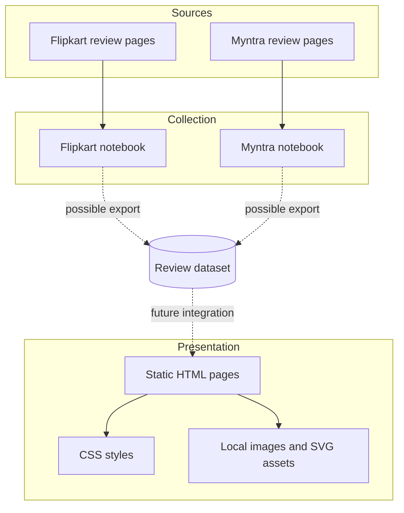
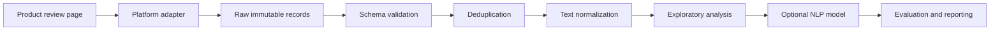

# 🏛️ Architecture and system boundaries

## Current architecture

The tracked repository has two visible areas: Jupyter collection experiments for Flipkart and Myntra, and a static HTML/CSS frontend under `Frontend/`. The tracked tree does not establish a backend service, live API, database, or frontend-to-analysis integration.

Dashed edges describe possible boundaries, not verified integrations.

## Component responsibility

| Component | Responsibility | Important boundary |
|---|---|---|
| Flipkart notebook | Platform-specific collection experiment | Page markup and availability can change |
| Myntra notebook | Separate collection experiment | Selectors and exposed metadata may differ |
| Static frontend | Render existing project pages | No verified live analysis API |
| Assets | Supply page imagery and icons | Keep relative paths and filename case correct |
| Documentation | Explain current code and proposals | Do not overstate implementation |

## Recommended analytical pipeline

## Failure boundaries

- A changed selector should fail visibly rather than silently output malformed records.
- Network errors must be distinguished from a valid page containing zero reviews.
- Missing ratings must remain null, not become zero.
- Raw review text should remain separate from normalized text.
- Model failure must not overwrite source records.

## Decisions to record

Document future choices about storage, language support, label definitions, model selection, frontend integration, and retention in architecture decision records. Each decision should state context, alternatives, trade-offs, and consequences.
