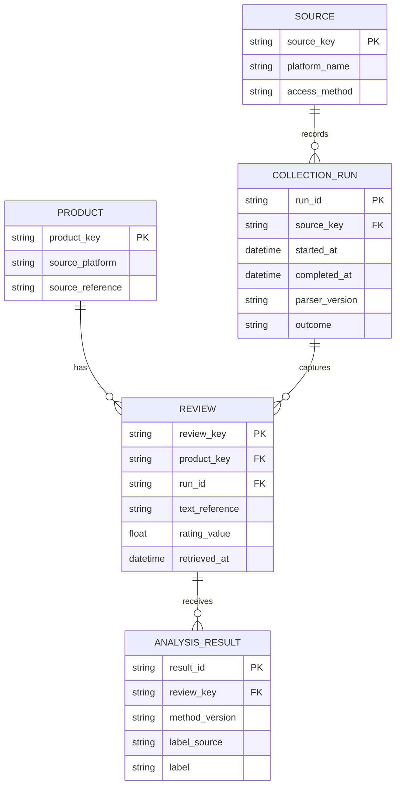

# 🗄️ Data storage and database design

## 1. Current status

The inspected repository tree does not contain a database migration directory, schema definition, database client, or database configuration. The existing notebooks can hold data in memory while they run, but notebook variables are not durable storage. No database engine should be described as part of the current implementation.

A database is not automatically necessary. For small, permitted research experiments, versioned CSV or Parquet exports plus a run manifest may be simpler and easier to reproduce. Choose persistence only when query patterns, concurrency, access control, or data volume justify the added operational cost.

## 2. Storage decision criteria

| Option | Suitable when | Main trade-off |
|---|---|---|
| CSV | Small, tabular, human-inspectable exports | Weak typing and inefficient large-scale reads |
| Parquet | Analytical workloads and larger datasets | Less convenient for casual manual editing |
| SQLite | Local application or single-user prototype | Limited concurrent write workload |
| PostgreSQL | Multi-user service, relational integrity, controlled access | Requires operations, backups, and migrations |
| Object storage | Immutable raw files and versioned artefacts | Requires a separate catalogue/query layer |

Do not select a database merely to make the architecture diagram look complete.

## 3. Suggested logical entities

The following model is a proposal, not a committed schema.

The model intentionally avoids reviewer accounts and profile tables. Product feedback analysis does not require building a database of reviewer identities.

## 4. Data lifecycle

Treat source-derived records as immutable evidence where retention is permitted. Store transformed text and model predictions as derived artefacts with explicit version identifiers. A rerun should not silently overwrite a prior analysis result because doing so destroys the ability to compare methods.

Recommended lifecycle:
1. Validate that the data collection method is allowed.
2. Write a run manifest with source, timestamps, parser version, and counts.
3. Store only minimum necessary fields.
4. Validate the common schema before accepting records.
5. Record a deterministic transformation version.
6. Store analytical outputs separately from raw records.
7. Apply retention and deletion rules to raw and derived copies.

## 5. Integrity and indexing

If a relational database is introduced, use primary keys, foreign keys, unique constraints, and explicit nullability. Index fields that are genuinely used for lookup, such as product key, source platform, retrieval date, and run identifier. Avoid indexing personal information because it should not be collected by default.

Use parameterized queries. Validate input before it reaches a query. Keep migrations in source control and test upgrades from a clean database as well as from the previous supported schema.

## 6. Security and operations

Use least-privilege database roles. Keep credentials in environment variables or a managed secret store, never in notebooks or Git. Encrypt backups, restrict access, test restore procedures, and document who can access source-derived data. Log operational events without writing raw review bodies or secrets into application logs.

## 7. Decision gate

Before implementing a database, write down the data volume, read/write patterns, retention period, deletion obligations, user access model, backup expectations, and operating cost. If a simple local file format satisfies the use case, prefer that until a measured need for a database appears.
