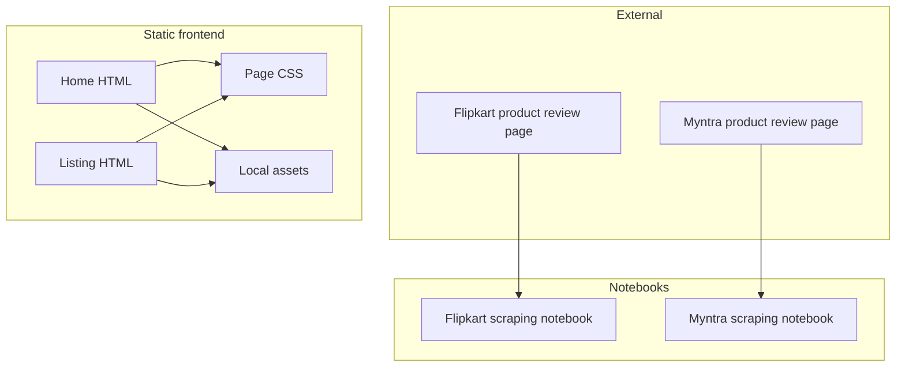
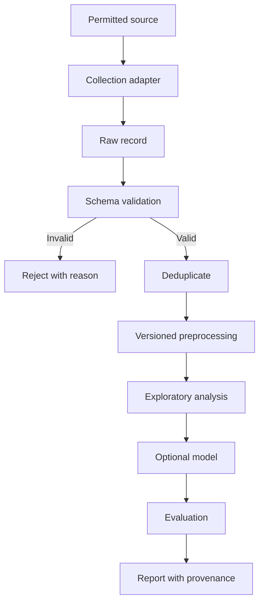
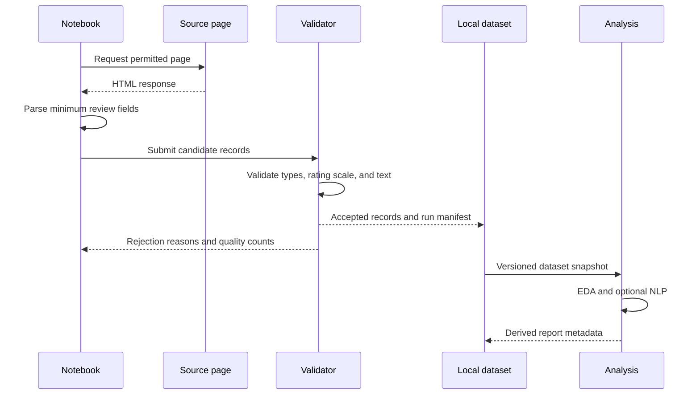
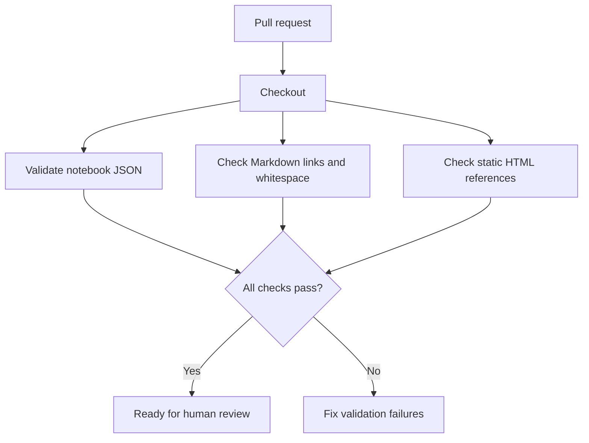

# 🧭 Architecture and workflow diagrams

This page collects the editable Mermaid diagrams used to explain the project. Diagrams describe current boundaries and proposed future flows separately. Dashed arrows and labels such as “proposed” must not be interpreted as implemented integrations.

## 1. Current repository boundary

## 2. Proposed data lifecycle

## 3. Proposed review record lifecycle

## 4. Proposed CI validation

CI should not send requests to retail platforms. Use synthetic fixtures for deterministic tests.

## 5. Diagram maintenance rules

- Keep Mermaid source in Markdown, not screenshots alone.
- Use descriptive node labels and explicit decision branches.
- Label proposed or optional components clearly.
- Update diagrams when implementation boundaries change.
- Verify rendering on GitHub after editing.
- Do not add made-up database tables, endpoints, or model stages to the current architecture diagram.
