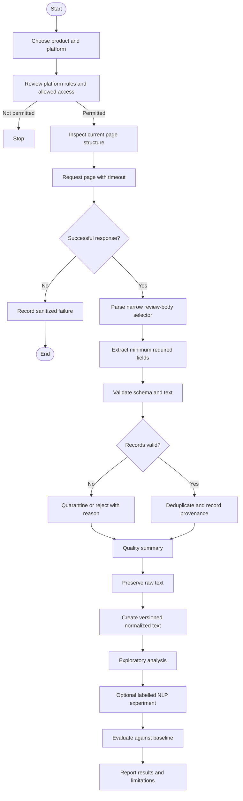

# 🔄 Collection, validation, and analysis workflow

## 1. Workflow overview

The current collection entry points are the two platform-specific Jupyter notebooks. Their role is exploratory: request a product page, parse review-related HTML, and inspect extracted text. A reliable analytical system needs additional stages around collection, quality control, preprocessing, evaluation, and reporting.

## 2. Planning a collection run

Before opening a notebook, define:
- platform and product page;
- research question;
- fields required to answer it;
- permitted collection method;
- date and time window;
- expected sample scope;
- retention and deletion plan;
- parser version and execution environment.

Do not collect every field merely because it appears in the page HTML. Review content may be sufficient; reviewer identity and profile information are not required for this project.

## 3. Request and parsing stage

Use explicit timeouts and check the HTTP response before parsing. Do not assume a successful TCP connection means the page contains product reviews. A response may be a redirect, an error, a consent screen, or an unexpected page.

Use narrow selectors and inspect a small sample. The Flipkart notebook currently uses a broad `div.row` selector, which can include unrelated product and reviewer information. The Myntra notebook uses a platform-specific review container. Both selectors need verification against current permitted markup before reuse.

## 4. Validation stage

Validate each record before it enters analysis:
1. Confirm the source and product context are present.
2. Confirm the text field is a string and not navigation or boilerplate.
3. Normalize whitespace without changing the original field.
4. Parse ratings only when the source scale is understood.
5. Keep missing values missing.
6. Remove exact duplicates using stable IDs where available.
7. Record rejected rows and the reason for rejection.
8. Track record counts by collection run.

## 5. Preprocessing stage

Preserve a raw text column. Create derived fields for Unicode normalization, whitespace cleanup, language detection, tokenization, and any lemmatization or stemming. Each transformation should have a version or documented configuration so an analysis can be reproduced.

Do not remove negation by default. Do not assume English-only text. Product reviews may contain transliteration, code-mixing, emojis, abbreviations, and misspellings.

## 6. Analysis stage

Start with exploratory summaries: review count, rating distribution, missingness, duplicate rate, review length, language coverage, and frequent terms. If sentiment labels are introduced, define how they were obtained. Ratings converted into sentiment classes are proxy labels and must be reported as such.

## 7. Evaluation and reporting

Compare any classifier with a simple baseline. Use held-out data, avoid duplicate leakage, and report class-wise precision, recall, F1, macro-F1, support, and a confusion matrix. Inspect false positives and false negatives rather than relying on accuracy alone.

## 8. Failure handling

A zero-record output can mean no visible reviews, changed markup, an access denial, a failed request, or a broken selector. Do not silently treat all these states as success. Stop collection on access restrictions and record only sanitized diagnostic information.
